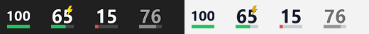
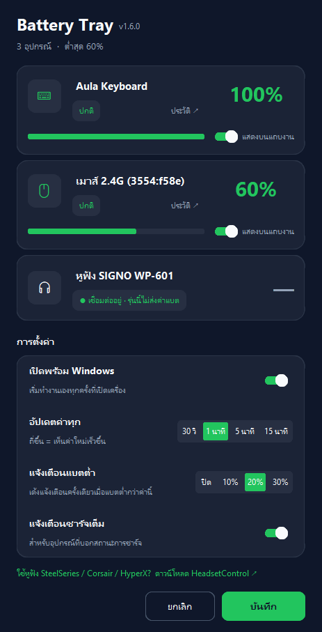
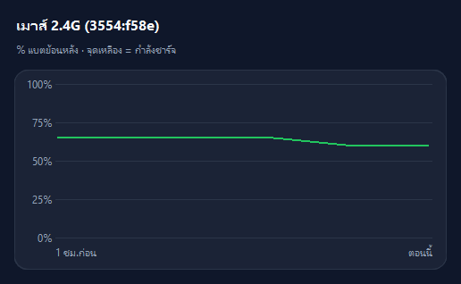

# Battery Tray

แสดง % แบตเตอรี่ของเมาส์ / คีย์บอร์ด / หูฟังไร้สาย เป็นไอคอนข้างนาฬิกาบน Windows



- ตัวเลขใหญ่ = % แบต, แถบล่าง = ระดับแบต (เขียว / ส้ม ≤40% / แดง ≤20%)
- สายฟ้าสีเหลือง = กำลังชาร์จ · ตัวเลขสีเทา = ค่าล่าสุด (อุปกรณ์หลับอยู่)
- รองรับ taskbar ทั้ง**ธีมมืดและธีมสว่าง** (สลับสีตัวเลขให้เองตามธีมของ Windows)
- **ประมาณเวลาที่เหลือ** เช่น "เหลือ ~2 วัน" จากอัตราการลดของแบตตั้งแต่ชาร์จครั้งล่าสุด (ขึ้นหลังมีข้อมูล ≥2 ชม. และแบตลด ≥3%)
- แจ้งเตือนเมื่อแบตต่ำ และเมื่อ**ชาร์จเต็ม** (อุปกรณ์ที่บอกสถานะการชาร์จ)
- **อัปเดตอัตโนมัติ:** เช็คเวอร์ชันใหม่ทุกครั้งที่เปิดแอปและทุก 6 ชม. (หรือคลิกขวา → *เช็คอัปเดต*) → คลิกขวา → *อัปเดตเป็น vX ตอนนี้* (โหลด ติดตั้ง แล้วเปิดใหม่ให้เอง การตั้งค่ายังอยู่ครบ)
- ดับเบิลคลิกไอคอน = หน้าตั้งค่า · คลิกขวา = รีเฟรช, ค้นหาอุปกรณ์ใหม่, ปิด
- **รายงานปัญหา / แจ้งอุปกรณ์:** คลิกขวาที่ไอคอน → เปิดฟอร์มบน GitHub ที่กรอกเวอร์ชันและรายชื่ออุปกรณ์ไว้ให้แล้ว (ถ้ามี `error.log` แอปจะเปิดโฟลเดอร์ให้ลากแนบ)

## ติดตั้ง (ง่ายสุด — ไม่ต้องมี Python)

1. ดาวน์โหลด **BatteryTray.exe** จากหน้า [Releases](../../releases/latest)
2. ดับเบิลคลิก — แอป**ติดตั้งตัวเอง**ไว้ที่ `%LOCALAPPDATA%\BatteryTray` และตั้งให้เปิดพร้อม Windows ให้เลย (ลบไฟล์ที่ดาวน์โหลดมาทิ้งได้)
3. หน้าตั้งค่าจะเปิดขึ้นเองครั้งแรก — ตั้งชื่ออุปกรณ์/การแจ้งเตือนได้ตามชอบ

Windows SmartScreen อาจเตือนเพราะไฟล์ไม่มีลายเซ็น — กด *More info → Run anyway*

ถ้าไอคอนไปอยู่ใต้ลูกศร `^` ให้ลากออกมาวางบน taskbar หรือเปิด
Settings → Personalization → Taskbar → Other system tray icons → เปิด **BatteryTray**

### ติดตั้งจากซอร์ส

ติดตั้ง [Python 3](https://www.python.org/downloads/) → ดาวน์โหลด repo → ดับเบิลคลิก `Install.bat`
(เลิกใช้: `Uninstall.bat`, สร้าง exe เอง: `build.bat`)

## หน้าตั้งค่า

 

- เปิด/ปิดไอคอนของแต่ละอุปกรณ์ และตั้งชื่อเรียกเอง
- กด **ประวัติ ↗** ที่การ์ดอุปกรณ์ → กราฟ % แบตย้อนหลังสูงสุด 7 วัน (จุดเหลือง = ช่วงชาร์จ)
- เปิดพร้อม Windows
- แจ้งเตือนเมื่อชาร์จเต็ม (เปิด/ปิดได้)
- อัปเดตค่าทุก 30 วินาที / 1 / 5 / 15 นาที
- แจ้งเตือนเมื่อแบต ≤ 10% / 20% / 30% หรือปิดแจ้งเตือน

## อุปกรณ์ที่รองรับ

| ยี่ห้อ / ชนิด | วิธีอ่าน | สถานะ |
|---|---|---|
| เมาส์ดองเกิล 2.4G Compx/ATK (VID `3554`) — VXE, ATK ฯลฯ | โปรโตคอลที่ ATK HUB ใช้ (ถอดจาก USB capture) | ✅ ทดสอบกับ VXE R1 |
| คีย์บอร์ดดองเกิล Compx (VID `3554`) — AULA ฯลฯ | โปรโตคอล AULA จาก [womier-l65-linux](https://github.com/deepan-alve/womier-l65-linux) | ✅ ทดสอบกับ Aula |
| **Logitech** เมาส์ / คีย์บอร์ด / หูฟัง — Unifying, Bolt, Lightspeed, สาย | HID++ 2.0 (feature 0x1004 / 0x1000 / 0x1001) | 🧪 ยังไม่ได้ทดสอบกับของจริง |
| **หูฟัง SteelSeries, Corsair, HyperX, Logitech, Roccat ฯลฯ** | [HeadsetControl](https://github.com/Sapd/HeadsetControl) — วาง `headsetcontrol.exe` ไว้ข้างโปรแกรม | 🧪 ยังไม่ได้ทดสอบกับของจริง |
| อุปกรณ์ **Bluetooth** ทุกยี่ห้อที่ Windows รู้ค่าแบต | `DEVPKEY_Bluetooth_Battery` ของ Windows | 🧪 ยังไม่ได้ทดสอบกับของจริง |

รายชื่อหูฟังที่ HeadsetControl รองรับ: [ดูที่นี่](https://github.com/Sapd/HeadsetControl#supported-headsets)

**ยังไม่รองรับ:** Razer, อุปกรณ์ที่ดองเกิลไม่ส่งค่าแบตมาให้คอม (เช่น หูฟัง SIGNO WP-601 `040b:0897`)

**ช่วยทดสอบหน่อย!** ถ้าใช้กับยี่ห้อ/รุ่นที่ขึ้น 🧪 แล้วได้ผลยังไง (ใช้ได้หรือไม่ได้) คลิกขวาที่ไอคอน → **รายงานปัญหา / แจ้งอุปกรณ์** หรือ [กรอกฟอร์มตรงนี้](../../issues/new?template=device-report.yml)

### เพิ่มยี่ห้อใหม่

1. ติดตั้ง Wireshark + USBPcap
2. อัด USB ตอนโปรแกรมของยี่ห้อนั้นกำลังแสดง % แบต
3. หาคำสั่งที่ส่งออก (`URB_CONTROL out` / SET_REPORT) และคำตอบที่มีตัวเลขตรงกับ % ที่โปรแกรมแสดง
4. สร้างไฟล์ใหม่ใน `batterytray/devices/` ที่มีฟังก์ชัน `*_devices()` คืนรายการ `{key, kind, name, read}` แล้วเพิ่มลงใน `discover()` ของ `batterytray/devices/__init__.py`
5. เพิ่มการทดสอบด้วยคำตอบจริงที่อัดได้ใน `batterytray/selftest.py`

### โครงสร้างโค้ด

| ไฟล์ | หน้าที่ |
|---|---|
| `battery_monitor.py` | จุดเริ่มโปรแกรม (`--test` = รันชุดทดสอบ) |
| `batterytray/devices/` | อ่านแบตแต่ละแหล่ง: `compx`, `logitech`, `headsetcontrol`, `bluetooth`, `nobattery` |
| `batterytray/app.py` | แอป tray: อ่านค่าเป็นรอบ, ไอคอน, แจ้งเตือน, เมนู |
| `batterytray/settings_ui.py` | หน้าตั้งค่า + กราฟประวัติ |
| `batterytray/icons.py` · `history.py` | วาดไอคอน · ประวัติแบต/ประมาณเวลาที่เหลือ |
| `batterytray/updater.py` · `system.py` | อัปเดตตัวเอง · ติดตั้ง/Startup/กันเปิดซ้ำ |
| `batterytray/report.py` | ลิงก์รายงานปัญหา |
| `batterytray/config.py` | ค่าคงที่, cache, error log |

## ทดสอบ

```
py battery_monitor.py --test
```

ตรวจเฟรมของทุกโปรโตคอลกับคำตอบจริง/จำลอง แล้วพิมพ์ค่าแบตของอุปกรณ์ที่เสียบอยู่

## License

MIT
